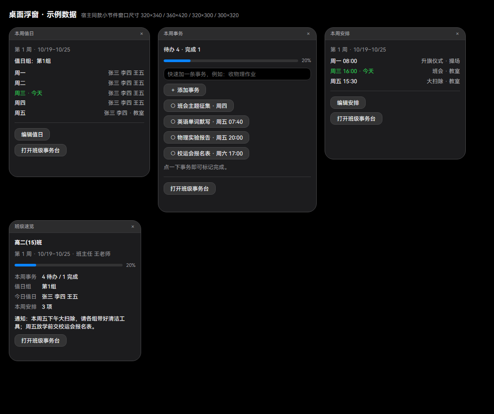

# 班级事务台 · Aurora 插件项目

> GitHub：<https://github.com/LinePixel2025/aurora-class-management>

插件 **v2.2.0**，最低宿主 **Aurora 0.5.3（插件 API v1）**。班级事务管理系统：

- **2 张页面型桌面小组件**：班级速览（含本周值日与每天例行）与今日事务（含每天例行与本周安排）——桌面层、不启用毛玻璃，可拖动 / 缩放，位置由 Aurora 记住；右上角无关闭键，小组件里可直接快速添加、完成 / 恢复、删除今日待办；
- **2 个页面型右栏面板**：**班级事务台**（`/class`，今日 / 值日 / 安排 / 设置 4 视图）与**班级周历**（`/calendar`，垂直 7 天时间线），两者共用同一套「黑板 / 备课本」设计系统，都可直接删除事务与安排；
- **删除不再难找**：事务台里未完成、**已完成**事务与每条安排都有行内「删除」按钮，走页面内确认弹层；
- **本周内过去天可编辑**：周历里只限制「过去周」只读；本周内周一到昨天的事务 / 安排也能编辑、删除、完成（新增事务仍只允许今天与未来）；
- **今日事务**：事务按天管理，界面只显示今天；旧事务保留最近 7 天，超出自动清理，可由 Agent 按日期查回；
- **整周值日**：一周由一组负责，按分组顺序每周轮换，不再按天换人；值日在 4 个界面都拆成「组名徽章 / 轮换方式 / 成员 / 备注」四层显示，不再挤成一行；
- **基础安排（每天例行）**：早读、眼保健操这类每天都做的事设一次即可，每条带适用星期（默认周一~周五），每周自动铺到周历日卡、事务台与小组件，不用每周重排；
- **Agent 可改**：13 个插件工具 + 1 个 Skill + 3 条斜杠命令（`/class` / `/week-plan` / `/calendar`）；写入后 2 面板 + 2 小组件自动刷新，不用手动点刷新；
- **可选提醒**：每日简报 / 截止提醒 / 周一值日提醒 / **安排到点前提醒**（每条安排可单独开关与提前分钟，未设则用默认提前量），默认全关，可在插件设置里开启并配置提醒时间；摘要类走系统通知中心，准点类（截止 / 安排）走 Aurora 0.5.6+ 的**流光提醒 `ctx.banner`**（屏幕顶端 + 置顶卡片 + 可选朗读），旧宿主自动回落系统通知；
- 数据只存插件私有存储，不联网、不读写用户文件、不接触 Aurora 凭据。




更多截图：[小组件课堂放大](docs/images/widgets-classroom-dark.png) · [事务台编辑弹层](docs/images/panel-board-edit-dark.png) · [空今日](docs/images/panel-board-empty-dark.png) · [删除确认弹层](docs/images/board-confirm-dark.png) · [值日](docs/images/panel-duty-dark.png) · [安排](docs/images/panel-schedule-dark.png) · [过去周只读](docs/images/panel-schedule-past-dark.png) · [设置](docs/images/panel-settings-dark.png) · [事务台浅色](docs/images/panel-board-light.png) · [浅色小组件](docs/images/widgets-light.png) · [空小组件](docs/images/widgets-empty-dark.png) · [周历浅色](docs/images/calendar-light.png)

## 交付物

```
class-management/                 插件包（zip 根目录）
  manifest.json / main.js / lib/ / ui/ / skills/ / types/ / README.md
  lib/page-core.js                页面 RPC 公共工具（参数归一 / 动作结果 / 错误兜底）
  lib/board-page.js               页面型「班级事务台」后端：4 视图数据与全部页面动作
  lib/calendar.js                 页面型「班级周历」后端：7 天数据与事务 / 安排 / 值日 / 通知动作
  lib/widget-page.js              页面型桌面小组件后端：WidgetData 与快速添加 / 完成 / 删除
  lib/notify.js                   可选系统通知与去重状态（notify.v1）
  ui/calendar.css                 全插件页面共用设计系统（令牌 / 基础 / 按钮 / 弹层 / 表单）
  ui/board.html|css|js            页面型班级事务台（/class）
  ui/calendar.html|css|js         页面型班级周历（/calendar，运行在宿主沙箱）
  ui/widget-overview.html|js      页面型桌面小组件「班级速览」
  ui/widget-tasks.html|js         页面型桌面小组件「今日事务」
  ui/widget.css                   两张小组件共用的紧凑样式
GitHub Releases（安装包附件，仓库外）  v2.1.2 安装包；本地构建输出 dist/class-management-2.2.0.zip（已 gitignore）
dev/test-plugin.mjs               离线全链路测试（mock 宿主 + 宿主原版 zod 清单解析，166/166）
dev/preview.mjs                   页面型事务台 / 小组件预览与截图（生成 dev/.cache，可拷入 docs/images）
dev/preview-calendar.mjs          页面型周历预览与截图（合成页面 + mock auroraPlugin）
dev/page-api.md                   页面型面板 / 小组件 API 契约（开发用，不随插件发布）
dev/.cache/                       预览 HTML / PNG / 字体缓存（已 gitignore）
scripts/build.ps1                 校验 → 测试 → 打 zip → 输出 SHA-256
scripts/dev-register.ps1          注册 / 移除开发目录（需先退出 Aurora，自动备份配置）
docs/images/                      README 用截图（预览脚本生成后拷入）
docs/aurora-widget-desktop-level.md  Aurora 桌面层与页面型小组件能力说明（不随插件包发布）
```

> 本仓库**不包含** Aurora 官方的 `plugin-dev-kit/`（第三方工具包）。需要独立静态校验时，把它放到项目根的 `plugin-dev-kit/`；`dev/test-plugin.mjs` 会优先从本机 Aurora 安装目录提取宿主原版 zod 清单解析器。

## 安装

### 方式 A：安装插件包（推荐）

1. 从 [Releases](https://github.com/LinePixel2025/aurora-class-management/releases) 下载最新插件包；或本地构建：

   ```powershell
   powershell -ExecutionPolicy Bypass -File scripts\build.ps1
   ```

   产物为 `dist\class-management-2.2.0.zip`。

2. Aurora → 设置 → 插件 → 已安装 → **安装插件包**，选择下载的 zip；
3. 核对权限、工具后安装。桌面上会出现 2 张小组件；右栏「插件面板」或 `/class` / `/calendar` 可打开事务台与周历。
4. 可选：在插件详情点「信任此插件」，让只读工具（`get_overview` / `list_tasks`）免逐次确认。

### 方式 B：开发目录（改代码自动重启）

1. **完全退出 Aurora**；
2. 运行：

   ```powershell
   powershell -ExecutionPolicy Bypass -File scripts\dev-register.ps1
   ```

   脚本会先备份 `%APPDATA%\Aurora\config.json`，再把本插件目录加入 `plugins.devDirs`；
3. 启动 Aurora → 设置 → 插件 → 开发，确认已加载；
4. 修改 `main.js` / `lib/` / `ui/` 后约 300ms 防抖自动重启插件。

移除开发目录：`scripts\dev-register.ps1 -Remove`（同样需要先退出 Aurora）。

> 开发目录加载的插件没有安装记录，工具默认逐次确认；日常使用建议走方式 A。

## 桌面小组件

| 小组件 | 内容 | 默认尺寸 | 形态 | 层级 / 材质 |
| --- | --- | --- | --- | --- |
| 班级速览 | 班级名、周次、班主任、今日事务计数与完成率、本周值日组与成员 / 备注、本周安排前 3 项（今天高亮）、班级通知摘要 | 320×300 | 页面型 `ui/widget-overview.html` | `desktop` / `none` |
| 今日事务 | 今日日期与计数、完成率、快速添加、待办行（完成 / 恢复、截止信息、删除）、已完成区（可恢复 / 删除）、本周安排（今天高亮） | 360×460 | 页面型 `ui/widget-tasks.html` | `desktop` / `none` |

- 都是 Aurora 的**桌面层小组件**（无边框、不占任务栏），可拖动、缩放；位置与显隐由 Aurora 持久化。
- **字号随窗口缩放**：文字、间距与控件一起按窗口宽度等比放大（默认约 13px，最大 40px）。
  在教室一体机 / 投屏上把小组件拉到半屏或全屏，后排也能看清；内容放不下时在窗口内滚动。
- **右上角不显示关闭键**：两张小组件声明 `hideCloseButton: true`，宿主标题栏只保留标题；
  隐藏 / 恢复改到 设置 → 插件 → 班级事务台 →「显示在桌面」。该字段需要支持它的 Aurora 版本，旧宿主会忽略。
- `desktop` 是尽力而为：宿主按“普通窗口 + Win32 owner 亲和 + 恢复守护”实现，owner 亲和失败时回退普通层（`normal`）。
- **不启用毛玻璃**：v2.1.0 起 `windowMaterial: "none"`，小组件为不透明卡片；v2.0.0 的 Acrylic 方案已移除。
- 小组件页面运行在宿主沙箱 webview 中，只通过 `window.auroraPlugin.request` / `onEvent` 与插件后端通信。
- 在小组件里可以直接快速添加今日事务、点圆点完成 / 恢复、删除待办（页面内二次确认，不需要打开面板）。
- **右上角的 `×` 由宿主绘制**，不属于插件页面 DOM；本插件通过清单 `hideCloseButton: true` 请求宿主不渲染它。
  隐藏 / 恢复在 设置 → 插件 → 班级事务台 →「显示在桌面」操作（位置沿用）。
- 层级 / 材质可在 Aurora 设置 → 插件 → 班级事务台 → 对应小组件逐 widget 覆盖（跟随插件 / 置顶 / 普通 / 桌面层）。
- 小组件始终显示**今天 / 本周**；跨天 / 跨周时插件自动推送刷新。

## 右栏面板

共 2 个面板，都是**页面型**（清单 `entry` 指定 HTML，运行在宿主页面沙箱）。
两者共用 `ui/calendar.css` 中的设计令牌与组件：深色「晚自习黑板」、浅色「备课本」、宋体标题、粉笔黄主色。

### 班级事务台（页面型）

命令 `/class` 或右栏「插件面板 → 班级事务台」打开，入口 `ui/board.html`，顶部为 4 个视图 tab：

- **今日**：今日统计 / 完成率 / 本周值日胶囊；添加今日事务（内容、截止日期、截止时间、优先级、分类、负责人）；
  未完成事务行「编辑 / 删除」；**已完成事务也每条都能删除**（同时保留恢复为待办）；本周安排预览；班级通知直接编辑保存；
- **值日**：本周值日组 / 成员 / 备注、轮换预览、临时换组（弹层）、分组与轮换顺序编辑（弹层）；整周一组，**没有按天覆盖**；
- **安排**：添加安排（周几 / 时间 / 事项 / 地点 / 备注）；每条安排行「编辑 / 删除」；
- **设置**：班级信息（去插件设置里改）、数据统计、按范围清理、写入示例周（仅空周）、Agent 用法说明。

值日 / 安排视图带 `‹ 上一周 / 本周 / 下一周 ›`；事务只显示今天，周切换只影响值日、安排和通知。
删除、清理、写示例周都使用**页面内确认弹层**，确认后立即生效并显示状态条提示。
过去周为只读（切回本周 / 未来周即可编辑）。

### 班级周历（页面型）

命令 `/calendar` 或右栏「插件面板 → 班级周历」打开，入口 `ui/calendar.html`：

- **垂直 7 天时间线**：每天一张卡片，显示当天事务与安排；顶部有周次、待办 / 完成 / 逾期统计和本周值日；
- **事务**：在当天行内添加；点圆圈按钮完成 / 撤销，点「编辑」打开编辑弹层（内容、截止、优先级、分类、负责人），可删除；
  可拖动事务到其他日期；
- **页内编辑**：本周安排、值日组与班级通知都能直接改；
- **可编辑范围**：只限制**过去周**只读；本周内过去几天（周一到昨天）也能编辑 / 删除已有事务与安排，
  新增事务仍只允许今天与未来，拖拽不能落到过去日期；
- 页面运行在宿主沙箱，只通过 `window.auroraPlugin.request` / `onEvent` 通信，没有内联脚本、没有 CDN、没有 `fetch`。

## 验证

```powershell
# 1.（可选）本地有 Aurora 官方 plugin-dev-kit 时，跑清单 / 权限 / 静态校验
node plugin-dev-kit/tools/check-plugin.mjs class-management

# 2. 离线全链路测试：mock 宿主 + 从本机 Aurora app.asar 提取的宿主原版清单 zod 解析器
node dev/test-plugin.mjs

# 3. 页面预览与截图（写入 dev/.cache，不随插件发布）
node dev/preview.mjs

# 4. 页面型周历预览与截图（合成 HTML + mock auroraPlugin，写入 dev/.cache）
node dev/preview-calendar.mjs

# 5. 构建 zip
powershell -ExecutionPolicy Bypass -File scripts\build.ps1
```

当前离线验证结果：

- `check-plugin.mjs`：通过（`com.classmanagement.board` v2.2.0，2 个页面型面板、2 个页面型桌面小组件、3 条命令）；
- `dev/test-plugin.mjs`：**168/168 项检查通过**；
  覆盖时间 / 周次、存储读取、串行并发写、旧数据迁移（含旧数据补齐 `routines`）、2 个页面型小组件、13 个工具、
  页面型事务台 4 视图与全部动作（含已完成事务删除、安排删除、值日 / 分组 / 通知 / 清理 / 示例周 / 基础安排逐条增删改）、
  页面型周历（7 天 load、事务与安排动作、拖动、基础安排按星期铺到日卡、本周过去天可编辑与过去周只读）、命令、
  推送目标 / 条数（2 面板 + 2 小组件 = 4 条）、可选提醒（四类开关 / 提醒时间与提前量 / 流光 `ctx.banner` 与系统通知两条通道 /
  旧宿主无 `ctx.banner` 时回落 / `banner` 返回 false 不重试 / 去重 / 重启后不重发 / 不额外推送）、
  整周计划失败回滚、跨天 / 跨周刷新、容量修剪，
  以及页面静态约束（无内联脚本 / 事件、无 fetch / 本地存储 / 外链、相对资源存在）；
- 清单通过从本机 Aurora 提取的宿主原版 zod `parsePluginManifest`；
- `node dev/preview.mjs`：生成事务台 4 视图 / 空态 / 浅色 / 三类弹层（事务、安排含提醒、基础安排）/ 删除确认与 2 张小组件共 15 张截图到 `dev/.cache/`
  （含 640×520 / 720×900 的课堂放大预览，验证字号随窗口缩放）；
  `node dev/preview-calendar.mjs`：生成周历 3 张截图；README 配图由这些图拷入 `docs/images/`；
- 本地构建产物 `dist/class-management-2.2.0.zip`：125.3 KB，SHA-256 `BA10B1E6F154E48ECB8038C518B0264F069436CE33D78992EC5C956177608010`；
  manifest 在 zip 根，条目使用正斜杠，无 `node_modules` / `dev/` / 缓存文件。GitHub Release 上仍是在线的 v2.1.2 安装包，未重新发布。

真机验收清单（需要你在 Aurora 里点一遍）：

- [ ] 插件状态「运行中」，桌面出现 **2 张小组件**（班级速览 / 今日事务），为不透明卡片、无毛玻璃；
- [ ] 小组件可拖动 / 缩放，重启 Aurora 后位置保留；标题栏无 `×`（`hideCloseButton: true`），
      隐藏 / 恢复在设置 →「显示在桌面」操作；
- [ ] 小组件里能快速添加今日事务、点圆点完成 / 恢复、删除待办（二次确认）；
- [ ] `/class` 打开页面型班级事务台：4 个 tab 可切换，今日 / 值日 / 安排 / 设置视觉与周历一致；
- [ ] 事务台里未完成与**已完成**事务都能删除；每条安排都能编辑 / 删除；删除走页面内确认弹层；
- [ ] 值日在事务台今日 / 值日视图、周历头部、班级速览四处都是「组名徽章 + 轮换方式 + 成员 + 备注」分层显示，长名单换行不糊；
- [ ] 「安排 → 基础安排」能逐条添加 / 编辑 / 删除，勾选的星期会在周历对应日卡、事务台今日与两张小组件里出现；
- [ ] 安排勾选「到点前提醒」后行上有「提前 n 分钟」标记；到点前收到一条通知，同一条当天不重复；
- [ ] 周历页本周内过去几天的事务 / 安排可以编辑 / 删除；切到上一周为只读；
- [ ] Agent 调用工具后 2 个面板 + 2 张小组件立即更新（不点刷新）；
- [ ] 跨天 / 跨周后小组件自动显示新一天 / 新一周；昨天事务在 7 天内可用 Agent 查回；
- [ ] 可选通知：开启四类提醒后到点收到一次，重启 Aurora 后不重复发送；
- [ ] 停用 / 卸载插件后小组件关闭。

## Agent 工具

`get_overview`、`list_tasks`、`add_task`、`update_task`、`complete_task`、`delete_task`、
`set_duty_week`、`set_duty_groups`、`add_schedule`、`delete_schedule`、`set_routines`、
`set_announcement`、`apply_week_plan`。

- 工具名为 `plugin.com.classmanagement.board.<name>`；
- 只读工具注册为 `readonly: true`，只读档也能用；
- 事务按天：`add_task` 默认今天，`date` 可排未来某天；`list_tasks` / `get_overview` 的 `date` 可查最近 7 天历史；
- 值日按周：`set_duty_week` 指定某一周的组，`set_duty_groups` 编辑分组与轮换顺序；`set_duty_day` 已删除；
- 基础安排是全班长期数据：`set_routines` **整表替换**（每条带 `weekdays`，默认周一~周五），改一条也要带上其余条目；
- 安排提醒：`add_schedule` / `apply_week_plan` 的 `remind` + `remindLead`，需在插件设置开启「安排提醒」；
- 写入后通过 `ctx.ui.panelEvent({ panelId: 'board' | 'calendar' } | { widgetId: ... })` 推送 `board.changed`，
  一次变更最多 4 条（2 个面板 + 2 个小组件）；
- 斜杠命令 3 条：`/class`（打开班级事务台）、`/week-plan`（总结今日计划）、`/calendar`（打开班级周历）；
- Skill `class-board` 说明了 `date` / `weekOffset` 的分工与批量写入方式。

## 数据与隐私

- 业务数据在 `%APPDATA%\Aurora\plugin-data\com.classmanagement.board\storage.json`（键 `board.v1`，内部 schema v2），
  界面状态在 `ui.v1`，通知去重状态在 `notify.v1`；
- 单值 ≤ 240 KB（宿主上限 256 KB），每周事务 ≤ 80、安排 ≤ 60、最多 40 周；事务历史保留 7 天，超限先修剪最旧周；
- 权限只有 `tools / skills / commands / storage / config / logging / ui.panels / ui.widgets / notifications`；
- 插件进程以当前用户权限运行，**不是 OS 沙箱，安装即信任**；本插件不发起网络请求、不读写插件目录以外的文件。

## 系统通知（可选）

默认全部关闭，在 Aurora 设置 → 插件 → 班级事务台 开启并配置：

- **每日简报**：到达提醒时间后发送今日待办 / 完成计数与本周值日组，每天最多一次；
- **截止提醒**：对今天截止（或未填截止日期）的事务，在截止时间前 N 分钟提醒；每条事务每天最多一次，一次最多汇总 3 条；
- **周一值日提醒**：每周一到达提醒时间后发送本周值日组与成员，每周最多一次。

配置字段：`notifyDaily`（每日简报，默认 `false`）、`notifyTime`（提醒时间，默认 `07:30`，本地 `HH:mm`）、
`notifyDue`（截止提醒，默认 `false`）、`notifyDueLead`（提前分钟，默认 `10`，范围 0–120）、
`notifyDuty`（周一值日提醒，默认 `false`）。

去重状态按天 / 周 / 每条事务记录在 `notify.v1`，与业务数据 `board.v1` 分开；插件重启后不会重复发送。
通知通过宿主 `ctx.notify` 发送，**只在 Aurora 运行时生效**：不是系统级后台常驻提醒，插件不常驻后台，
Aurora 退出期间也不会补发；通知内容全部来自本地数据，不联网。

## 平台特性与边界（Aurora 0.5.3）

- **2 个页面型面板**（`board` / `calendar`）与 **2 张页面型桌面小组件**（`week-overview` / `week-tasks`）
  都由清单 `entry` 指定插件目录内 HTML，由宿主在页面沙箱中加载；页面只通过
  `window.auroraPlugin.request` / `onEvent` 通信，无内联脚本、无 CDN、无 `fetch`。
- **桌面小组件窗口**是宿主创建的无边框浮动 `BrowserWindow`（不占任务栏），不是插件自建窗口；
  Aurora 0.5.2 起支持 `windowLevel`（`floating` / `normal` / `desktop`）与 `windowMaterial`（`none` / `acrylic`），
  0.5.3 起支持 `hideCloseButton`：
  本项目 2 张小组件声明 `desktop` + `none`（v2.0.0 曾用 `acrylic`，v2.1.0 已去掉毛玻璃），
  并通过 `hideCloseButton: true` 请求宿主不渲染右上角关闭键。
- **`desktop` 是尽力而为的桌面层**：由宿主以“普通窗口 + Win32 owner 亲和 + 恢复守护”实现，owner 亲和失败时回退普通层（`normal`）；
  它不是壁纸层嵌入、不是桌面图标层、也不是点击穿透。
- **小组件标题栏由宿主绘制**：标题与右上角的隐藏按钮不在插件页面 DOM 里；本插件声明
  `hideCloseButton: true` 让宿主不渲染该按钮，插件只负责标题栏下方的内容。隐藏 / 恢复在
  设置 → 插件 → 「显示在桌面」操作。
- **层级可由用户覆盖**：Aurora 设置 → 插件 → 班级事务台 → 对应小组件，可逐 widget 改为跟随插件 / 置顶 / 普通 / 桌面层；
  插件只声明默认值，实际层级以宿主的用户覆盖为准。
- **推送目标有限**：一次业务变更向 2 个面板（`board` / `calendar`）+ 2 张桌面小组件各推 1 条 `board.changed`，共 4 条，
  符合本项目自设的单次 ≤5 条；宿主实际限速 20 条/秒、payload ≤64 KB。
- 单插件最多 **4 个小组件**，本项目使用 2 个；提示条（edge-bar）是另一种槽位，本项目未使用。
- 开发目录插件没有安装记录，工具即使声明 `safe` 也会逐次确认。
- 小组件默认按宿主级联位置出现，初次安装请拖到顺手的位置；位置 / 尺寸 / 显隐由 Aurora 持久化。

## 卸载

- 设置 → 插件 → 班级事务台 → 停用 / 卸载（可选同时删除数据）；
- 开发目录：退出 Aurora 后运行 `scripts\dev-register.ps1 -Remove`。

## 故障排查

| 现象 | 处理 |
| --- | --- |
| 安装时报「清单校验失败」 | 本地有 Aurora 官方工具包时运行 `node plugin-dev-kit/tools/check-plugin.mjs class-management`；否则把完整错误发到 issue |
| 小组件不显示 | 设置 → 插件 → 班级事务台 →「显示在桌面」开关；或检查是否停用 |
| 小组件显示「正在加载…」或空白 | 设置 → 插件 → 打开插件日志，检查 `%APPDATA%\Aurora\logs\plugins\com.classmanagement.board.log`；页面型小组件加载失败时宿主会提示 `页面加载失败` |
| 小组件被隐藏了 | 设置 → 插件 → 班级事务台 → 对应小组件「显示在桌面」重新打开，位置沿用 |
| 桌面层不生效 / 被其他窗口盖住 | 设置 → 插件 → 班级事务台 → 对应小组件，检查层级是否被用户覆盖为「跟随插件 / 置顶 / 普通」；`desktop` 不置顶，属预期 |
| 页面型面板打不开 / 白屏 | 检查插件日志；页面只允许自身资源，若手动改过 `ui/*.html` 的 CSP / 资源路径会加载失败 |
| 删除按钮禁用 | 过去周只读：切回本周或未来周；本周内过去几天的事务与安排仍可删除 |
| 工具每次都确认 | 在插件详情「信任此插件」；开发目录模式无法免确认 |
| Agent 改了但看不到 | 确认改的是**今天**（小组件只显示今天）；查历史用 `list_tasks` / `get_overview` 的 `date` |
| 昨天的事务不见了 | 事务按天清空，今天只显示今天；旧事务保留 7 天，可用 Agent 按日期查回 |
| 写入失败「数据已超过 240 KB」 | 事务台 → 设置 → 清理旧数据 / 清理整周数据 |
| 改代码没生效 | 开发目录模式约 300ms 自动重启；或在插件详情点「重启」 |

## License

MIT。见 [LICENSE](LICENSE)。
